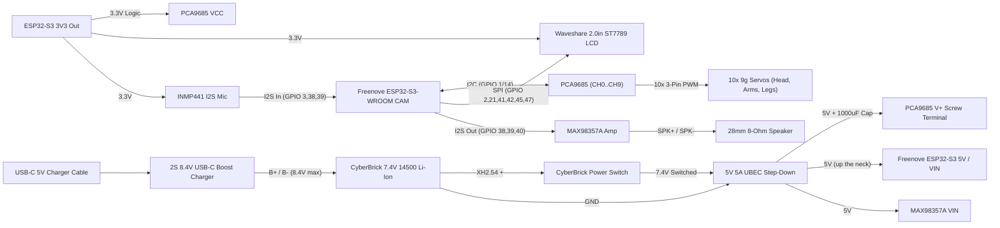

# Marvin Bipedal Waddle Robot — Complete Wiring Diagram

**Hardware Stack:**
- **Head:** Freenove ESP32-S3-WROOM CAM (`N16R8`), Waveshare 2.0" ST7789 IPS LCD, INMP441 I2S Mic, onboard OV2640/OV3660 camera
- **Torso / Neck / Legs:** 10× 9g 180° Servos (9× `MG90S` + 1× CyberBrick `PG001`), 28 mm 8Ω speaker
- **Backpack:** PCA9685 16-Ch PWM Driver, MAX98357A I2S Amp, CyberBrick `7.4V 14500` Li-Ion, CyberBrick `XH2.54` Power Switch, `2S 8.4V` USB-C Boost Charger, `5V 5A` UBEC

---

## 1. Power & Signal Architecture

---

## 2. Freenove ESP32-S3-WROOM CAM (`N16R8`) Pin Map

> **Reserved pins (DO NOT wire anything here):**
> - Camera (onboard): `GPIO 4, 5, 6, 7, 8, 9, 10, 11, 12, 13, 15, 16, 17, 18`
> - Octal PSRAM (`N16R8`): `GPIO 35, 36, 37`
> - Onboard WS2812 LED: `GPIO 48`
> - USB-UART (`CH340`) / Native USB-OTG: `GPIO 43, 44` / `GPIO 19, 20`

### A. Waveshare 2.0" ST7789 IPS LCD (`SPI` — inside Head)
| LCD Pin | Connect To | Wire Type / Location | Notes |
|---|---|---|---|
| **VCC** | ESP32-S3 `3V3` | Short wire (~4 cm) inside Head | 3.3V power |
| **GND** | ESP32-S3 `GND` | Short wire inside Head | Common ground |
| **DIN (MOSI)** | ESP32-S3 `GPIO 47` | Short wire inside Head | SPI Data |
| **CLK (SCLK)** | ESP32-S3 `GPIO 21` | Short wire inside Head | SPI Clock |
| **CS** | ESP32-S3 `GPIO 41` | Short wire inside Head | Chip Select |
| **DC** | ESP32-S3 `GPIO 42` | Short wire inside Head | Data/Command |
| **RST** | ESP32-S3 `GPIO 2` | Short wire inside Head | Hardware Reset |
| **BL (Backlight)** | ESP32-S3 `GPIO 45` | Short wire inside Head | Backlight Enable (driven HIGH) |

### B. PCA9685 16-Channel PWM Driver (`I2C` — Backpack)
| PCA9685 Pin | Connect To | Wire Type / Location | Notes |
|---|---|---|---|
| **VCC** | ESP32-S3 `3V3` | Runs through Neck Arch | **MUST be `3.3V`** so I2C stays 3.3V-safe! |
| **GND** | Common `GND` | Torso / Backpack ground bus | Tied to ESP32 `GND` and UBEC `GND` |
| **SDA** | ESP32-S3 `GPIO 1` | Runs through Neck Arch | I2C Data (pull-ups onboard) |
| **SCL** | ESP32-S3 `GPIO 14` | Runs through Neck Arch | I2C Clock (pull-ups onboard) |
| **OE** | 🚫 **DO NOT CONNECT** | *Leave Floating* | Onboard pull-down keeps outputs **always enabled**. No wire needed! |
| **V+ / GND Terminal**| `5V 5A UBEC` Out (`+` / `-`)| Heavy gauge inside Backpack | Add **`1000 µF 16V` cap** across screw terminals |
| **Right Cascade Header** | 🚫 **DO NOT CONNECT** | *Leave Floating* | Only for chaining a 2nd board (unused) |

### C. Shared Full-Duplex `I2S0` Audio (`INMP441` Mic + `MAX98357A` Amp)
*(Note: Uses `GPIO 38, 39, 40` assuming the onboard MicroSD card slot is left empty. If you want to use MicroSD, move `38, 39, 40` to `GPIO 45` + `GPIO 19, 20` and flash/debug only via the `UART` USB-C port.)*

| Device | Pin | Connect To | Wire Type / Location | Notes |
|---|---|---|---|---|
| **INMP441 Mic** *(Head)* | **VDD** | ESP32-S3 `3V3` | Short wire inside Head | 3.3V logic |
| | **GND** | ESP32-S3 `GND` | Short wire inside Head | Common ground |
| | **L/R** | **Adjacent GND pad** | ⚡ **Local solder bridge on Mic PCB** | **NO wire to ESP32!** Solder blob selects Left channel |
| | **SD** | ESP32-S3 `GPIO 3` | Short wire inside Head | I2S Data In to ESP32 |
| | **SCK** | ESP32-S3 `GPIO 38` | Short wire inside Head | Shared `BCLK` trunk |
| | **WS** | ESP32-S3 `GPIO 39` | Short wire inside Head | Shared `LRC / WS` trunk |
| **MAX98357A Amp** *(Backpack)* | **VIN** | `5V` (from UBEC) | Inside Backpack | 5V gives full 3W volume |
| | **GND** | Common `GND` | Inside Backpack | Common ground |
| | **BCLK** | ESP32-S3 `GPIO 38` | Runs through Neck Arch | Shared `BCLK` |
| | **LRC** | ESP32-S3 `GPIO 39` | Runs through Neck Arch | Shared `LRC / WS` |
| | **DIN** | ESP32-S3 `GPIO 40` | Runs through Neck Arch | I2S Audio Data Out from ESP32 |
| | **GAIN** | 🚫 **DO NOT CONNECT** | *Leave Floating* | Internal pull-up sets gain to **9 dB** |
| | **SD** | 🚫 **DO NOT CONNECT** | *Leave Floating* | Left floating = **Always ON, mono mix (L+R)/2** |
| | **+ / -** | **28 mm 8Ω Speaker** | 2 wires into `torso_front` | Route speaker wires into front chest pocket |

---

## 3. PCA9685 Servo Channel Map (`CH 0` – `CH 9`)

| Channel | Joint | Location | Servo |
|---|---|---|---|
| **CH 0** | Head Pan (Yaw) | `torso_back` | CyberBrick `PG001` (`180°`) |
| **CH 1** | Head Tilt (Pitch) | `neck_yoke` | `MG90S` |
| **CH 2** | Left Shoulder Pitch | `torso_back` (`+X`) | `MG90S` |
| **CH 3** | Left Shoulder Roll | `shoulder_yoke_left` | `MG90S` |
| **CH 4** | Right Shoulder Pitch | `torso_back` (`-X`) | `MG90S` |
| **CH 5** | Right Shoulder Roll | `shoulder_yoke_right` | `MG90S` |
| **CH 6** | Left Hip Pitch | `pelvis` (`+X`) | `MG90S` |
| **CH 7** | Left Ankle Roll (Waddle) | `leg_left` | `MG90S` |
| **CH 8** | Right Hip Pitch | `pelvis` (`-X`) | `MG90S` |
| **CH 9** | Right Ankle Roll (Waddle) | `leg_right` | `MG90S` |

---

## 4. Wires Crossing the Neck (`Head` ↔ `Backpack`)
Only **8 thin wires** pass through the `neck_yoke` wire arch into the torso/backpack:
1. `5V` (UBEC → ESP32-S3 `5V`)
2. `GND` (Common Ground)
3. `3V3` (ESP32-S3 `3V3` → PCA9685 `VCC`)
4. `SDA` (`GPIO 1` → PCA9685 `SDA`)
5. `SCL` (`GPIO 14` → PCA9685 `SCL`)
6. `BCLK` (`GPIO 38` → MAX98357A `BCLK`)
7. `LRC` (`GPIO 39` → MAX98357A `LRC`)
8. `DIN` (`GPIO 40` → MAX98357A `DIN`)

*(Head Tilt `CH 1` servo cable simply plugs down through the neck into PCA9685 `CH 1`!)*

---

## 5. Safety Checklist Before First Power-On
1. **Unplug all servo horns first**, center `CH 0–9` to `90°` (`1500 µs`), then snap/screw horns on.
2. **Verify `PCA9685 VCC` = `3.3V` and `V+` = `5.0V`** with a multimeter before plugging in the ESP32-S3.
3. **Never power the servos from USB-C** on the ESP32-S3—USB-C on the ESP32-S3 is for flashing only; keep the UBEC switch OFF or unplug `5V` header when flashing via USB if your UBEC back-feeds `5V`.
4. **Charging:** Turn the CyberBrick power switch **OFF** while charging via the bottom `2S` USB-C port so the `2S` charger isn't fighting servo standby loads.
