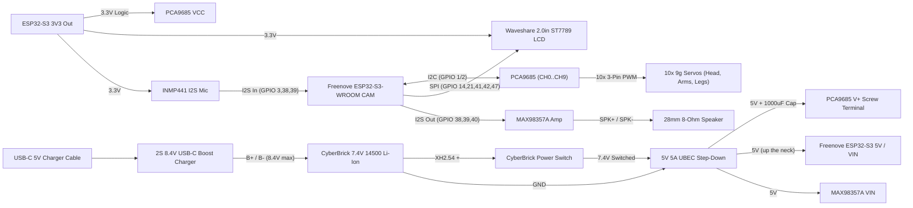

# Marvin Bipedal Waddle Robot — Complete Wiring Diagram

**Hardware Stack:**
- **Head:** Freenove ESP32-S3-WROOM CAM (`N16R8`), Waveshare 2.0" ST7789 IPS LCD, INMP441 I2S Mic, onboard OV2640/OV3660 camera
- **Torso / Neck / Legs:** 10× 9g 180° Servos (9× `MG90S` + 1× CyberBrick `PG001`), 28 mm 8Ω speaker
- **Backpack:** PCA9685 16-Ch PWM Driver, MAX98357A I2S Amp, CyberBrick `7.4V 14500` Li-Ion, CyberBrick `XH2.54` Power Switch, `2S 8.4V` USB-C Boost Charger, `5V 5A` UBEC

---

## 1. Power & Signal Architecture

---

## 2. Freenove ESP32-S3-WROOM CAM (`N16R8`) Pin Map

> **Reserved pins (DO NOT wire anything here):**
> - Camera (onboard): `GPIO 4, 5, 6, 7, 8, 9, 10, 11, 12, 13, 15, 16, 17, 18`
> - Octal PSRAM (`N16R8`): `GPIO 35, 36, 37`
> - Onboard WS2812 LED: `GPIO 48`
> - USB-UART (`CH340`) / Native USB-OTG: `GPIO 43, 44` / `GPIO 19, 20`

### A. Waveshare 2.0" ST7789 IPS LCD (`SPI` — inside Head)
| LCD Pin | Connect To (ESP32-S3) | Wire Color (suggested) | Notes |
|---|---|---|---|
| **VCC** | `3V3` | Red | 3.3V power |
| **GND** | `GND` | Black | Common ground |
| **DIN (MOSI)** | `GPIO 47` | Blue | SPI Data |
| **CLK (SCLK)** | `GPIO 21` | Yellow | SPI Clock |
| **CS** | `GPIO 14` | Orange | Chip Select |
| **DC** | `GPIO 41` | Green | Data/Command |
| **RST** | `GPIO 42` | White | Reset |
| **BL** | `3V3` *(or `GPIO 45`)* | Purple | Tie to `3V3` for always-on backlight |

### B. PCA9685 16-Channel PWM Driver (`I2C` — Head → Neck → Backpack)
| PCA9685 Pin | Connect To | Notes |
|---|---|---|
| **VCC** | ESP32-S3 `3V3` | **MUST be `3.3V`** so I2C stays 3.3V-safe! |
| **GND** | Common `GND` | Tied to ESP32-S3 `GND` and UBEC `GND` |
| **SDA** | `GPIO 1` | I2C Data (pull-ups are already on PCA9685) |
| **SCL** | `GPIO 2` | I2C Clock |
| **V+ / GND Terminal** | `5V 5A UBEC` Out (`+` / `-`) | Add **`1000 µF 16V` cap** across `+` and `-` |

### C. Shared Full-Duplex `I2S0` Audio (`INMP441` Mic + `MAX98357A` Amp)
*(Note: Uses `GPIO 38, 39, 40` assuming the onboard MicroSD card slot is left empty. If you want to use MicroSD, move `38, 39, 40` to `GPIO 45` + `GPIO 19, 20` and flash/debug only via the `UART` USB-C port.)*

| Device | Pin | Connect To | Notes |
|---|---|---|---|
| **INMP441 Mic** *(Head)* | `VDD` | ESP32-S3 `3V3` | 3.3V only |
| | `GND` | `GND` | Common ground |
| | `L/R` | `GND` | Selects Left I2S channel |
| | `SD` | `GPIO 3` | I2S Data In to ESP32-S3 |
| | `SCK` | `GPIO 38` | Shared `BCLK` |
| | `WS` | `GPIO 39` | Shared `LRC / WS` |
| **MAX98357A Amp** *(Torso/Backpack)* | `VIN` | `5V` (from UBEC) | 5V gives full 3W speaker volume |
| | `GND` | `GND` | Common ground |
| | `BCLK` | `GPIO 38` | Shared `BCLK` |
| | `LRC` | `GPIO 39` | Shared `LRC / WS` |
| | `DIN` | `GPIO 40` | I2S Data Out from ESP32-S3 |
| | `SD` | Leave floating | Amp enabled (or tie to `3V3` for Left+Right/2) |
| | `+ / -` | **28 mm 8Ω Speaker** | Route 2 speaker wires to `torso_front` |

---

## 3. PCA9685 Servo Channel Map (`CH 0` – `CH 9`)

| Channel | Joint | Location | Servo |
|---|---|---|---|
| **CH 0** | Head Pan (Yaw) | `torso_back` | CyberBrick `PG001` (`180°`) |
| **CH 1** | Head Tilt (Pitch) | `neck_yoke` | `MG90S` |
| **CH 2** | Left Shoulder Pitch | `torso_back` (`+X`) | `MG90S` |
| **CH 3** | Left Shoulder Roll | `shoulder_yoke_left` | `MG90S` |
| **CH 4** | Right Shoulder Pitch | `torso_back` (`-X`) | `MG90S` |
| **CH 5** | Right Shoulder Roll | `shoulder_yoke_right` | `MG90S` |
| **CH 6** | Left Hip Pitch | `pelvis` (`+X`) | `MG90S` |
| **CH 7** | Left Ankle Roll (Waddle) | `leg_left` | `MG90S` |
| **CH 8** | Right Hip Pitch | `pelvis` (`-X`) | `MG90S` |
| **CH 9** | Right Ankle Roll (Waddle) | `leg_right` | `MG90S` |

---

## 4. Wires Crossing the Neck (`Head` ↔ `Backpack`)
Only **8 thin wires** pass through the `neck_yoke` wire arch into the torso/backpack:
1. `5V` (UBEC → ESP32-S3 `5V`)
2. `GND` (Common Ground)
3. `3V3` (ESP32-S3 `3V3` → PCA9685 `VCC`)
4. `SDA` (`GPIO 1` → PCA9685 `SDA`)
5. `SCL` (`GPIO 2` → PCA9685 `SCL`)
6. `BCLK` (`GPIO 38` → MAX98357A `BCLK`)
7. `LRC` (`GPIO 39` → MAX98357A `LRC`)
8. `DIN` (`GPIO 40` → MAX98357A `DIN`)

*(Head Tilt `CH 1` servo cable simply plugs down through the neck into PCA9685 `CH 1`!)*

---

## 5. Safety Checklist Before First Power-On
1. **Unplug all servo horns first**, center `CH 0–9` to `90°` (`1500 µs`), then snap/screw horns on.
2. **Verify `PCA9685 VCC` = `3.3V` and `V+` = `5.0V`** with a multimeter before plugging in the ESP32-S3.
3. **Never power the servos from USB-C** on the ESP32-S3—USB-C on the ESP32-S3 is for flashing only; keep the UBEC switch OFF or unplug `5V` header when flashing via USB if your UBEC back-feeds `5V`.
4. **Charging:** Turn the CyberBrick power switch **OFF** while charging via the bottom `2S` USB-C port so the `2S` charger isn't fighting servo standby loads.
