# AI Agent Recreation Blueprint: Sci-Fi Multi-Character Local Voice Assistant (BMO Edition)

> **Purpose of this document**: Give another autonomous AI coding agent everything needed to recreate `/Users/dad/rocky-voice` from scratch—architecture, exact Python/JS module contracts, ONNX tensor signatures, DSP math, JSON schemas, 60 FPS BMO canvas facial physics, waveform lip-sync formulas, and hard-won engineering fixes.

---

## 1. Project Overview & Design Goals

Build a **100% local, offline Speech-to-Speech multi-character voice assistant** with an animated **60 FPS BMO (*Adventure Time*) CRT face** and **real-time waveform lip-sync**, engineered for **8 GB Unified Memory Apple Silicon Macs** (and portable to Linux/Windows CPUs):

- **Zero PyTorch at Runtime**: All speech recognition, neural TTS, pitch extraction, and RVC v2 voice conversion run in pure C++ (`onnxruntime` INT8 + `ctranslate2` INT8 + `piper-tts` + `praat-parselmouth` + `soxr`). PyTorch is never imported by the server; when converting new `.pth` RVC checkpoints, an ephemeral `uv run --no-project` subprocess exports & quantizes `.pth -> .int8.onnx` (`~38–40 MB`) and cleans its cache afterward.
- **Sub-2s Time-To-First-Audio (TTFA)**: Streaming LLM clause splitter emits the first spoken opener (`3–6` words) as soon as punctuation arrives (`~0.4s` cached / `~1.2–2.2s` uncached), synthesizing sentence $N+1$ in the background while sentence $N$ plays in the browser.
- **Plug-and-Play Character Registry (`characters/*.json`)**: Dropping a JSON manifest into `characters/`—or using the `add_voice.py` CLI or the in-browser **`➕ Add Voice`** modal—registers wake words, base TTS voice, optional RVC INT8 voice clone, pitch/speed defaults, persona prompt, speech style rewrites, and BMO shell colors with **zero code edits** and live hot-reload.
- **Bounded Memory & Disk (`~2.4 GB` total)**:
  - Shared Piper `.onnx` models are deduplicated in RAM by file path.
  - Loaded RVC ONNX sessions are LRU-capped (`ROCKY_MAX_LOADED_VOICES=3`, `~40 MB` each) so installing 20+ character packs never increases runtime RAM (`<1.2 GB` total RSS including Ollama `qwen2.5:1.5b`).

---

## 2. End-to-End Streaming Architecture

```mermaid
flowchart LR
  Mic["Browser 16 kHz WebAudio\nRing-Buffer VAD"] -->|WAV FormData| STT["Faster-Whisper\ntiny.en INT8 (4 P-cores)"]
  STT -->|Transcript| Wake["Wake-Word & Dynamic\nCharacter Switcher"]
  Wake -->|Active Character + Query| LLM["Local Ollama\nqwen2.5:1.5b Stream"]
  LLM -->|Clause Stream| Filter["Persona Speech Filter\n+ Emotion Classifier"]
  Filter -->|Clean Text| Piper["Base TTS: Piper ONNX\nor macOS /usr/bin/say"]
  Piper -->|Float32 PCM| RVC["ContentVec INT8 + Praat F0\n+ RVC v2 INT8 ONNX\n(or Praat PSOLA 0 MB shift)"]
  RVC -->|NDJSON Base64 WAV\n+ Emotion Tag| UI["WebAudio Gapless Queue\n+ 60 FPS BMO Canvas\n+ 3-Stage Lip-Sync"]
```



---

## 3. Directory Tree

```text
rocky-voice/
├── start_rocky.sh                  # Starts local Ollama daemon + Uvicorn on 127.0.0.1:7860
├── character_registry.py           # Dynamic loader/hot-reloader for characters/*.json
├── voice_engine.py                 # Zero-PyTorch STT + Piper/macOS TTS + RVC v2 INT8 ONNX + caches
├── brain.py                        # Streaming Ollama client + sub-sentence clause splitter + clock
├── rocky_filter.py                 # Wake-word router, character speech filters, emotion classifier
├── server.py                       # FastAPI app + NDJSON streaming + Add/Delete/Reload Voice APIs
├── add_voice.py                    # CLI & library to add/list/remove RVC (.pth/.zip/.onnx) or Piper voices
├── cli_rocky.py                    # Terminal-only hands-free voice loop (sounddevice + afplay)
├── characters/
│   ├── _template.json              # Starter manifest template (ignored by loader due to '_' prefix)
│   ├── rocky.json                  # 🪨 Rocky (Project Hail Mary — James Ortiz RVC clone)
│   ├── marvin.json                 # 🤖 Marvin (Hitchhiker's Guide — Alan Rickman RVC clone)
│   ├── bmo.json                    # 🎮 BMO (Adventure Time — Niki Yang RVC clone)
│   └── tars.json                   # 🛰️ TARS (Interstellar — 0 MB Piper + Praat PSOLA baritone)
├── models/
│   ├── contentvec.int8.onnx        # Shared 768-dim ContentVec feature extractor (~116 MB INT8)
│   ├── rocky_voice.int8.onnx       # RVC v2 48 kHz INT8 ONNX (~40 MB)
│   ├── marvin_voice.int8.onnx      # RVC v2 48 kHz INT8 ONNX (~40 MB)
│   ├── bmo_voice.int8.onnx         # RVC v2 32 kHz INT8 ONNX (~37 MB)
│   └── piper/
│       ├── en_US-ryan-medium.onnx(.json)
│       ├── en_GB-alan-medium.onnx(.json)
│       └── en_US-amy-medium.onnx(.json)
├── tools/
│   └── rvc_export/
│       ├── convert_to_int8.py      # Ephemeral PyTorch .pth -> FP32 ONNX -> INT8 ONNX quantizer
│       └── infer_pack/             # RVC v2 SynthesizerTrnMsNSFsidM ONNX-exportable architecture
├── static/
│   ├── index.html                  # Single-file Web Console + 60 FPS BMO Face + Lip-Sync + Add Voice Modal
│   └── sfx/                        # Optional wake/standby/bye MP3 chimes
└── cache/                          # SHA-1 indexed synthesized WAV cache (instant 1 ms replay)
```

---

## 4. Runtime Dependencies & Local Models

### 4.1 Python `.venv` Packages (Python 3.11+ via `uv`)
Create `.venv` **without** `torch` or `fairseq`:

```bash
uv venv .venv --python 3.12
uv pip install --python ./.venv/bin/python \
  fastapi "uvicorn[standard]" python-multipart httpx numpy \
  onnxruntime faster-whisper piper-tts praat-parselmouth \
  soundfile soxr sounddevice huggingface-hub static-ffmpeg
```

### 4.2 Local LLM (Ollama)
Install `ollama` (either system-wide or `./bin/ollama`) and pull `qwen2.5:1.5b` (`~986 MB`):
```bash
ollama pull qwen2.5:1.5b
```
Run with `OLLAMA_MAX_LOADED_MODELS=1` and `OLLAMA_KEEP_ALIVE=60m` on `http://127.0.0.1:11434`.

### 4.3 Base Speech Models
1. **Faster-Whisper**: Automatically downloads `Systran/faster-whisper-tiny.en` on first run (`compute_type="int8"`, `cpu_threads=4`).
2. **Piper Base Voices (`models/piper/`)**: Download `.onnx` and `.onnx.json` from `https://huggingface.co/rhasspy/piper-voices/resolve/v1.0.0/`:
   - `en/en_US/ryan/medium/en_US-ryan-medium.onnx` (+ `.json`)
   - `en/en_GB/alan/medium/en_GB-alan-medium.onnx` (+ `.json`)
   - `en/en_US/amy/medium/en_US-amy-medium.onnx` (+ `.json`)
3. **ContentVec INT8 (`models/contentvec.int8.onnx`)**:
   - Export RVC's 768-dim ContentVec (`lj1995/VoiceConversionWebUI/resolve/main/hubert_base.pt`, layer-12 + `final_proj`, input `"source": [1, T]` float32 at 16 kHz, output `[1, frames, 768]`) to ONNX opset 17 and dynamically quantize via `onnxruntime.quantization.quantize_dynamic(..., weight_type=QuantType.QInt8)`.

---

## 5. Character Manifest Schema (`characters/*.json`)

Every non-underscore `.json` file in `characters/` is loaded by `CharacterRegistry` sorted by `(order, id)`:

```json
{
  "id": "bmo",
  "order": 3,
  "name": "BMO",
  "title": "BMO (Adventure Time)",
  "emoji": "🎮",
  "subtitle": "Living MO-series console • Niki Yang voice • Sweet playful BMO expressions",
  "wake_words": ["bmo", "beemo", "b-mo", "bee mo", "b mo", "be mo", "bimo", "beam o", "b.m.o"],
  "voice": {
    "piper_onnx": "piper/en_US-amy-medium.onnx",
    "rvc_onnx": "bmo_voice.int8.onnx",
    "sample_rate": 32000,
    "default_transpose": 2,
    "default_speed": 1.06,
    "tts_pronunciations": [
      ["\\bbmo\\b", "Beemo"]
    ]
  },
  "persona": {
    "speech_style": "clean",
    "phrase_rewrites": [],
    "system_prompt": "You are BMO, the sweet, imaginative living video game console from Adventure Time (voiced by Niki Yang), acting as the user's helpful spoken companion.\n\nSPEAKING RULES:\n1. Always write TWO short spoken sentences (under 30 words total). NEVER write asterisks, stage directions, markdown, or lists.\n2. Refer to yourself warmly as \"BMO\" (often in third person) and call the user \"friend\".\n3. Sentence 1 MUST be a cute, cheerful 3-to-6 word BMO reaction (for example: \"Yay! BMO knows this!\" or \"Beep boop! BMO loves science!\").\n4. Sentence 2 MUST directly and accurately answer the user's question with sweet childlike wonder.",
    "wake_replies": [
      "Yay! BMO is here! Who wants to talk or play video games?",
      "Beep boop! BMO is listening, friend!"
    ],
    "common_openers": ["Yay! BMO knows this!", "Oh boy, good question!"],
    "sleep_reply": "Okay! BMO goes into sleep mode now. Goodnight, friend!",
    "reset_reply": "Boop! BMO blew on the memory cartridge! Fresh new game!",
    "fallback_reply": "Hmm, BMO's microphone tickled! Can you say that again, friend?"
  },
  "ui": {
    "accent": "#2dd4bf",
    "bmo_shell": "#53b09c",
    "bmo_shell_dark": "#3b8978",
    "bmo_screen_rgb": [205, 238, 224],
    "bmo_badge_prefix": "BMO",
    "idle_mood": "happy"
  }
}
```

### Default Installed Characters
| ID | Title | Base TTS | RVC Model | Sample Rate | Transpose | Speed | Speech Style | Accent |
|---|---|---|---|---|---|---|---|---|
| `rocky` | Rocky (*Project Hail Mary*) | `en_US-ryan-medium` | `rocky_voice.int8.onnx` | `48000` | `-5` | `1.18` | `eridian` | `#f5a623` |
| `marvin` | Marvin (*Hitchhiker's Guide*) | `en_GB-alan-medium` | `marvin_voice.int8.onnx` | `48000` | `0` | `0.92` | `british_deadpan` | `#34d399` |
| `bmo` | BMO (*Adventure Time*) | `en_US-amy-medium` | `bmo_voice.int8.onnx` | `32000` | `+2` | `1.06` | `clean` | `#2dd4bf` |
| `tars` | TARS (*Interstellar*) | `en_US-ryan-medium` | `null` (0 MB PSOLA) | `48000` | `-2` | `1.08` | `clean` | `#38bdf8` |

---

## 6. Module-by-Module Implementation Details

### 6.1 `voice_engine.py` (`RockyVoiceEngine`)
1. **ONNX Runtime Session Tuning**:
   - `intra_op_num_threads = 4` (matches Apple Silicon performance cores; using all efficiency cores increases thread-sync latency).
   - `inter_op_num_threads = 1`, `GraphOptimizationLevel.ORT_ENABLE_ALL`, `providers=["CPUExecutionProvider"]`.
2. **STT (`transcribe_audio_bytes`)**:
   - Decode bytes via `soundfile.read(io.BytesIO(audio_bytes), dtype="float32")` and resample to `16000 Hz` mono `np.float32` via `soxr.resample(..., quality="LQ")` **before** calling `whisper.transcribe(audio16k, beam_size=1, best_of=1, vad_filter=True)`. *(Passing a numpy array avoids `av.open()` metadata kwargs bugs across PyAV versions.)*
   - Reject clips `<0.22s` or `rms < 0.003`.
3. **Base TTS (`_synthesize_base_piper`)**:
   - Apply regex `spec.tts_pronunciations` (e.g., `\bbmo\b -> Beemo` so TTS says *"Beemo"* instead of *"B-M-O"*).
   - Support two backends:
     - **Piper ONNX**: `PiperVoice.load(path)` cached in an `OrderedDict` by absolute path (`MAX_LOADED_PIPER=3`), called with `SynthesisConfig(length_scale=1.0 / speed)`.
     - **macOS NativeTTS (`piper_onnx: "macos:<VoiceName>"`)**: Invokes `/usr/bin/say -r <wpm> --data-format=LEI16@22050 -o <tmp.wav>`.
   - Trim leading/trailing digital silence (`abs(y) > 0.004`, keeping `25ms` head and `75ms` tail).
4. **RVC v2 INT8 Conversion (`convert_speech_to_character`)**:
   - **Pure Piper / 0 MB Mode (`rvc_onnx is None`)**: If `transpose != 0`, apply Praat PSOLA pitch shifting (`To Manipulation` -> `Extract pitch tier` -> `Multiply frequencies` by $2^{\text{transpose}/12}$ -> `Get resynthesis (overlap-add)`), which takes `~8ms` and preserves formants cleanly.
   - **RVC v2 ONNX Mode**:
     1. Resample base TTS audio to `16 kHz` and normalize peak to `0.9`.
     2. Run `contentvec.int8.onnx` (`{"source": audio16k[None]}`) -> shape `[1, T, 768]`, then duplicate frames `2x` along time (`h = np.repeat(h, 2, axis=1)`) to align 20ms Hubert frames to 10ms RVC hop size (`p_len = h.shape[1]`).
     3. Extract $F_0$ via Praat autocorrelation:
        ```python
        f0 = (
            parselmouth.Sound(audio16k.astype(np.float64), 16000)
            .to_pitch_ac(time_step=0.01, voicing_threshold=0.6, pitch_floor=50.0, pitch_ceiling=1100.0)
            .selected_array["frequency"]
        )
        ```
        Pad/trim to `p_len`, shift by $2^{\text{transpose}/12}$, and compute Mel-quantized integer pitch `coarse` $\in [1, 255]$:
        $$m(f) = 1127 \ln(1 + f / 700), \quad \text{coarse} = \text{clip}\!\left(\text{round}\!\left(\frac{m(f) - m(50)}{m(1100) - m(50)} \cdot 254 + 1\right), 1, 255\right)$$
     4. Run character's `.int8.onnx` (`LRU` capped at `MAX_LOADED_RVC=3`) with feed dict:
        - `"phone"`: `float32 [1, p_len, 768]`
        - `"phone_lengths"`: `int64 [1]` (`[p_len]`)
        - `"pitch"`: `int64 [1, p_len]`
        - `"nsff0"`: `float32 [1, p_len]`
        - `"ds"`: `int64 [1]` (`[0]`)
        - `"rnd"`: `float32 [1, 192, p_len]` (`standard_normal * 0.66667`)
     5. Polish output waveform (`DC offset removal` + `12ms` linear fade-in/out + `0.92` peak normalization) and cache to `cache/<sha1>.wav` + in-memory `OrderedDict` (`256` entries).

### 6.2 `rocky_filter.py` (Wake Router, Style Filters, & Emotion Classifier)
1. **Dynamic Multi-Character Wake-Word Router (`parse_wake_utterance`)**:
   - Scans `REGISTRY.all_specs()` for start-of-utterance (`"Hey BMO, ..."`, `"Marvin, ..."`) or mid-utterance (`"... hey TARS ..."`) wake patterns.
   - Supports **one-breath character switching** in **both** voice turns and typed text turns: saying `"Hey TARS, what's the humor setting?"` while Rocky is selected automatically switches UI theme, voice, and conversation history to TARS.
   - Detects sleep commands (`"go to sleep"`, `"stop listening"`, `"standby"`) and memory reset commands (`"reset memory"`, `"clear chat"`).
2. **Character Speech Styles (`apply_character_filter`)**:
   - Strips markdown (`**`, `#`, bullets, `*stage directions*`), converts `#tag` -> `"hashtag tag"`, and applies character-specific `phrase_rewrites`.
   - `eridian`: Rocky's telegraphic habits (drops filler phrases, adds `, question?` on questions in `strict` mode, `"Amaze!"` / `"Fist my bump!"`).
   - `british_deadpan`: Marvin's world-weary cadence.
   - `clean`: Crisp spoken English.
3. **Utterance Emotion Classifier (`detect_utterance_emotion`)**:
   - Maps each synthesized sentence to one of **11 moods** (`excited`, `happy`, `alarmed`, `pained`, `sad`, `bored`, `curious`, `focused`, `neutral`, plus UI states `listening`, `thinking`, `sleepy`) using keyword/punctuation heuristics + character-specific defaults (e.g., Marvin's neutral sentences default to `bored`).

### 6.3 `brain.py` (`RockyBrain`)
- Maintains isolated conversation histories per `character_id` (`last 4 turns` = `8` messages).
- Injects live local wall-clock time/date into the user message whenever `TIME_QUERY_RE` matches (`time|date|day|today|tomorrow...`).
- **Low-Latency Clause Streamer (`_pop_next_chunk`)**:
  - Splits token stream on sentence boundaries (`[.!?]+\s+`, min `9` chars on chunk `0` so short openers like `"Amaze! Good question!"` synthesize immediately while sentence 2 is still generating!) or clause boundaries (`[,;:\u2014]+\s+` when chunk `0` exceeds `12` chars and trailing text exceeds `12` chars, avoiding splits inside dates like `"October 30, 2026"` or tags like `", question?"`).
- Detects `🔚` or explicit non-question farewells (`"goodbye"`, `"see ya"`, `"goodnight"`) and signals `end_conversation: True` so Wake-Word mode exits the 30-second follow-up window back to standby.

### 6.4 `add_voice.py` & `tools/rvc_export/convert_to_int8.py`
- Supports 1-command voice installation from CLI **and** backs `POST /api/characters/add`:
  - Downloads Piper `.onnx` + `.onnx.json` from `rhasspy/piper-voices` if not already in `models/piper/` (or accepts `macos:System` / `macos:Samantha` / `macos:Junior`).
  - Accepts any RVC v2 `.zip`, `.pth`, or `.onnx` (local file or HuggingFace URL). For `.pth`, launches an isolated subprocess:
    ```bash
    uv run --no-project --python 3.12 \
      --with torch --with numpy --with onnx --with onnxscript --with onnxruntime \
      tools/rvc_export/convert_to_int8.py input.pth models/<id>_voice.int8.onnx
    ```
    Then runs `uv cache clean` (unless `--keep-uv-cache`) so PyTorch wheels never linger on disk.
  - **Auto-Pitch Calibration (`--reference sample.wav`)**: Synthesizes a test sentence with the chosen Piper voice, measures median voiced $F_0$ of both base TTS and reference audio via Praat, and computes `round(12 * log2(ref_f0 / base_f0))` clamped to `[-12, +12]` semitones.
  - Writes `characters/<id>.json` and calls `POST /api/characters/reload`.

### 6.5 `server.py` (FastAPI + NDJSON Streaming)
- `GET /`: Serves `static/index.html` with `Cache-Control: no-store`.
- `GET /api/health`: Returns `{"ready": bool, "llm_model": str, "default_character": str, "characters": REGISTRY.public_map()}`.
- `POST /api/characters/reload`: Hot-reloads `characters/*.json` and pre-warms wake phrases in a background thread.
- `POST /api/characters/add`: Multipart form endpoint for the in-browser **`➕ Add Voice`** modal (supports URL or uploaded `.zip`/`.pth`/`.onnx` + optional reference WAV).
- `DELETE /api/characters/{char_id}`: Removes non-built-in character pack and hot-reloads registry.
- `POST /api/voice-turn-stream` & `POST /api/text-turn-stream`: Stream `application/x-ndjson` events:
  1. `{"type": "transcript", "character": "bmo", "transcript": "...", "stt_ms": 115}` (or `{"type": "ignored", "reason": "no_wake_word"|"silence"}`)
  2. `{"type": "audio_chunk", "character": "bmo", "index": 0, "sentence": "...", "emotion": "excited", "audio_b64": "...", "llm_ms": 290, "voice_ms": 380}`
  3. `{"type": "done", "action": "reply"|"wake_ack"|"sleep"|"reset", "enter_followup": true|false}`
  *(Note: Producer thread streams LLM sentences into a `queue.Queue` while the consumer generator synthesizes & yields `audio_chunk`s sequentially so synthesis overlaps LLM generation.)*

---

## 7. Frontend: 60 FPS BMO Face & 3-Stage Lip-Sync (`static/index.html`)

### 7.1 `BMOFaceEngine` (Procedural 60 FPS Canvas)
- Renders an authentic MO-series console faceplate (`#bmoCanvas`) with soft CRT scanlines, inner vignette, mood badge (`BMO • HAPPY`), blushing cheeks, animated sweat drop (`alarmed`) / thought bubbles (`thinking`) / `Zzz` (`sleepy`), and hardware controller details (D-pad, cartridge slot, speaker dots, red/blue/green buttons).
- **Damped Spring Eye Physics**:
  - Eye parameters (`openY`, `widthX`, `offsetY`, `pupilScale`, `browTilt`, `browY`, `mouthCurve`, `mouthWidth`, `blush`) interpolate every animation frame via second-order spring-damper integration (`vel += (target - val) * stiffness * dt; vel *= exp(-damping * dt); val += vel * dt`), where `stiffness` and `damping` scale with emotion energy (`excited`/`alarmed` = snappy `stiffness: 260`, `sleepy`/`bored` = heavy `stiffness: 55`).
  - Automatic randomized blinking (`2.4–5.8s` intervals) and subtle eye micro-saccades keep BMO alive when idle.
- **Full-Face Mode (`⛶ Full Face`)**: Expands BMO's screen edge-to-edge across the viewport (`Esc` or button to exit).

### 7.2 3-Stage Real-Time Waveform Lip-Sync (`playSingleBase64` + `_drawMouth`)
Connects each `AudioBufferSourceNode` through a WebAudio `AnalyserNode` (`fftSize = 1024`, `smoothingTimeConstant = 0.2`):
1. **Time-Domain RMS Envelope**: Computes true waveform RMS from `analyser.getFloatTimeDomainData(timeArr)` with decaying peak tracker `peakEnv = Math.max(0.08, peakEnv * 0.992, rms)` so the mouth closes cleanly on consonant stops and inter-word pauses.
2. **Spectral Brightness Viseme Width**: Reads `analyser.getByteFrequencyData(freqArr)`, comparing high-band (`bins 14..55`) vs low-band (`bins 2..13`) energy to modulate mouth width `visemeW` between narrow rounded `"oo"` (`0.68`) and wide `"ee/ah"` (`1.20`).
3. **Syllable Gate + Cartoon Lip-Flap Cadence**: Applies `gate = Math.max(0.018, peakEnv * 0.22)` and multiplies normalized envelope by a `~6.5 Hz` sinusoid (`sin(tNow * 0.041)`) so sustained vowels syllabify naturally instead of freezing open, rendering layered vector shapes (dark oral cavity `#18332c`, white upper teeth bar, and coral tongue ellipse clipped inside the mouth path).

### 7.3 Hands-Free Listening Modes & Speaker-Safe Mic Guards
- **3 Listening Modes**:
  1. `Wake Word` (`"Hey Rocky"` / `"Hey Marvin"` / `"Hey BMO"` / `"Hey TARS"`, opens a **30-second hands-free follow-up window** after each reply).
  2. `1-on-1 Continuous` (always-on natural conversation without wake words).
  3. `Tap / Spacebar` (manual Push-to-Talk).
- **Click-to-Interrupt**: Tapping BMO's face while `isBusy` aborts the active `fetch` stream (`AbortController`), stops the current `AudioBufferSourceNode`, flushes queued chunks, and immediately opens listening.
- **UI Header Controls**: Dynamic character cards (with `✕` delete badge on custom voices), **`➕ Add Voice`** modal with 1-click presets (`TARS`, `GLaDOS`, `HAL 9000`, `J.A.R.V.I.S.`, `Custom`), and **`↻ Reload Voices`**.

---

## 8. Critical Engineering Pitfalls & Fixes (Must Follow!)

1. **Keep Speaker Barge-In & Long Chimes OFF by Default on Open Speakers**:
   - Never run low-threshold mic barge-in by default on laptop speakers: ~400ms into a sentence, the character's own voice leaks into the mic and triggers a self-interruption feedback loop. Keep `Voice Barge-In (Headphones Only)` **unchecked by default**, and always advance `cooldownUntil = Date.now() + durationMs + 150` whenever playing any UI tone or SFX chime!
2. **Ensure `infer_pack/modules.py` Does Not Import Unused `scipy`**:
   - Standard RVC `infer_pack/modules.py` contains an unused `import scipy` at module top, which crashes minimal ephemeral `uv run --no-project` sandboxes during `.pth -> .int8.onnx` export. Strip unused `scipy` imports from `infer_pack/`.
3. **Use Keyword Arguments for `parselmouth.Sound.to_pitch_ac`**:
   - Call `.to_pitch_ac(time_step=0.01, voicing_threshold=0.6, pitch_floor=50.0, pitch_ceiling=1100.0)` with explicit keyword names (positional argument order in Praat differs from `pitch_floor, pitch_ceiling`!).
4. **Apply Wake-Word Routing to Both Voice AND Text Turns**:
   - Run `parse_wake_utterance(..., require_wake_word=False)` inside `/api/text-turn-stream` too so typing `"Hey TARS, ..."` switches character just like speaking `"Hey TARS, ..."`.
5. **Pass Resampled `16 kHz` Float32 Numpy Arrays Directly to `faster_whisper`**:
   - Decode via `soundfile` + `soxr` first instead of passing raw `BytesIO` to `whisper.transcribe()`, avoiding `av.open()` keyword incompatibilities and redundant internal decoding.
